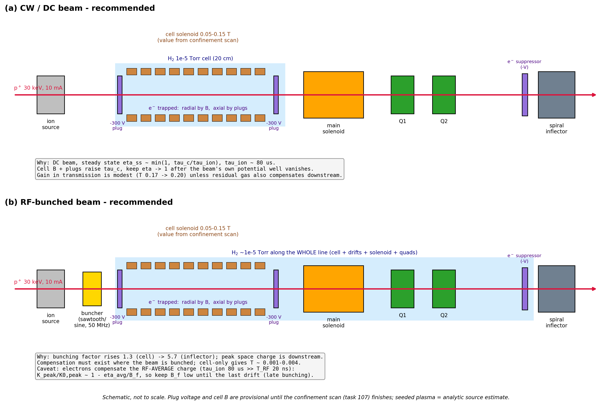

# Simulation Strategy Task List: CW and RF-Bunched Beams

Companion to [neutralizer_efficiency_strategy.md](neutralizer_efficiency_strategy.md).
Recommended configurations (schematic, not to scale):

Figure source: `scripts/make_recommended_config_sketch.py` (writes
`docs/physics_notes/figures/recommended_configurations.{png,pdf}`).

Two points set the strategy:

- A CW beam is helped by holding electrons in the cell long enough: a cell solenoid plus
  negatively biased end plugs.
- For an RF-bunched beam, the peak space charge builds up downstream: B_f rises from about 1.3 in
  the cell to 5.7 at the inflector (task 105). The electrons also compensate only the RF-averaged
  charge (tau_ion about 80 us, much longer than T_RF = 20 ns; f_pe about 28 MHz, below f_RF):
  `K_eff,peak / K0,peak ~ 1 - eta_avg / B_f`. Compensation therefore has to extend along the line,
  and bunching should happen late.

Status values: done, running, planned, blocked (with the reason).
All PIC cases start from a seeded plasma (analytic source estimate), not self-consistent
proton-impact ionization.

## Common tasks (both beams)

| ID | Task | Method | Output / decides | Depends on | Status |
|----|------|--------|------------------|------------|--------|
| C0 | Production DC matrix, seeded H2/Kr, 218 ns | WarpX ES, 64x64x512 | Core eta_net 0.96 (H2), 0.50–0.58 (Kr) | – | done (tasks 96–103) |
| C1 | Confinement scan: B_z = 0, 0.05, 0.15 T; seed T_e = 1, 10 eV; plugs 0 / 300 V | WarpX, 32x32x256, 650 ns, `scripts/run_confinement_scan.py` | tau_c = 0.7 us (0 T) to 2.15 us (0.15 T, 1 eV, no plugs); 5 mm, 300 V plugs shorten it ~4x; selected 0.15 T, 1 eV for C4 | – | done (task 107) |
| C2 | Extrapolate tau_c to the 80 us scale | Guiding-centre test electrons in the static plug + solenoid + beam-well fields with elastic e-H2 collisions and beam heating, 100 us (`scripts/trap_orbit_tracking.py`) | With >= 100 V plugs all electrons survive 100 us (classical bound eta_ss = 1); without plugs lost in ~2 us. PIC tau_c is collective or numerical: needs a PIC convergence check; possible overcompensation | C1 | done (task 114) |
| C3 | Plug-field effect on the beam | Beam rms emittance and size at the cell exit, plug on vs off (from C1 data) | 5 mm, 300 V plugs triple the exit divergence (7.6 → 23.9 mrad at 0.15 T) and quadruple eps_n,rms; no-plug beam leaves at 2.5 mm, 7.6 mrad | C1 | done (task 108) |
| C4 | Plug voltage and width scan around the C1 optimum | WarpX small grid, 0.15 T, 1 eV, 100–300 V, w = 5–20 mm, longer domain, `scripts/run_plug_scan.py` | Plugs >= 10 mm wide double to triple tau_c (3.4 → 7–9 us, eta_ss ~0.08) at +10–15% divergence; 5 mm plugs still harmful; selected 300 V, 10 mm for CW1 | C1, C3 | done (task 109) |
| C5 | Self-consistent build-up from zero | Needs a validated proton-impact ionization source (WarpX extension) | Build-up time with the trap | WarpX source work | blocked (no validated p+ impact source) |

## CW (DC) beam track

Target configuration: H2 cell at about 1e-5 Torr, cell solenoid 0.05–0.15 T, -300 V end plugs,
electron suppressor before the inflector (figure, panel a).

| ID | Task | Method | Output / decides | Depends on | Status |
|----|------|--------|------------------|------------|--------|
| CW1 | Best C1/C4 configuration on the production grid: 0.15 T, 1 eV, 300 V / 10 mm plugs | WarpX 64x64x672 (production dz, z in [-0.07, 0.27] m), 975 ns, `scripts/run_cw_best_config.py` | Core eta_net 0.91 (0.81–1.00) from 490 to 975 ns; tau_c 4.2 us (eta_ss >= 0.05); beam divergence made mostly in the uncompensated drift before the cell | C1, C4 | done (task 111) |
| CW2 | Transmission vs downstream compensation | Envelope model, eta_cell = 0.91 (CW1), eta_down 0–0.95, `scripts/transmission_vs_downstream.py` | 0.25 pi mm mrad: T >= 0.5 at eta_down 0.49, T >= 0.9 at 0.69; 0.5 pi mm mrad saturates at T ~0.56; 1.0 pi mm mrad emittance-dominated (T <= 0.16) | CW1 | done (task 112) |
| CW3 | Electron retention in the main-solenoid and quadrupole region | WarpX section model with seeded residual-gas plasma; quadrupoles do not trap electrons | Achievable eta_downstream (input to CW2) | C1 | planned |
| CW4 | Electron suppressor before the inflector | Axisymmetric (r, z) Poisson model with the compensated beam and an illustrative inflector leakage potential (`scripts/suppressor_scan.py`) | 20 V on-axis barrier needs -62 / -96 / -122 V (5 mm aperture) or -115 / -154 / -195 V (7.5 mm) at eta_down 0.5 / 0.7 / 0.9; lens effect negligible (f ~ km) | CW3 | done (task 115) |
| CW5 | Particle tracking through the line | 2D space-charge particle tracking (`scripts/track_to_inflector.py`): KV/Gaussian model beams with CW2 optics; PIC cell-exit beams with rematched optics | KV agrees with the envelope; Gaussian tails lower T to 0.77 / 0.93 at eta_down 0.7 / 0.9 (0.25 pi mm mrad); CW1 PIC beam T ~0.48 (too wide after the 7 cm uncompensated drift; hard-edge PIC solenoid did not focus); short-injection beam T = 1.0 at eta_down 0.9 | CW1, CW2 | done (task 116) |

## RF-bunched beam track

Target configuration: same cell, solenoid and plugs; H2 at about 1e-5 Torr along the whole line
up to the suppressor; bunching as late as possible (figure, panel b). Any change of the
buncher position from the baseline (buncher -> neutralizer -> solenoid -> Q1 -> Q2 -> inflector)
is an alternative-placement study and is labeled as such.

| ID | Task | Method | Output / decides | Depends on | Status |
|----|------|--------|------------------|------------|--------|
| B1 | Correct the bunched transport perveance | Envelope model with average-only compensation K = K0 (B_f - eta_avg), keep B_f (1 - eta) as the per-slice upper bound | Bunched T < 0.01 with any RF-averaged compensation; per-slice upper bound 0.99 (whole line, 0.25 pi mm mrad) | – | done (task 106) |
| B2 | Bunched-beam PIC in the cell | WarpX small grid, von Mises current profile; B_f = 1.3 (baseline cell) and B_f = 5 (bunch-focus study, labeled); best C1 configuration vs B = 0 | Electron retention through the 18 ns gaps; RF-averaged vs peak-bunch eta | C1 | planned |
| B3 | Late-bunching layout | Buncher in each downstream drift, voltage for best B_f at the inflector, peak slice with RF-averaged compensation (`scripts/late_bunching_layout.py`) | Gain B_f T_peak/T_DC: 0.01–0.06 for the baseline buncher, 1.8 between Q1 and Q2 (2.25 kV), ~5 only 7.5 cm before the inflector (8.7 kV, outside the ballistic model) | B1 | done (task 113, alternative-placement study) |
| B4 | Compensation of a strongly bunched beam downstream | WarpX section model of the gas-filled main solenoid at B_f = 3–6 | Whether electrons follow the bunches at all (f_pe vs f_RF) | B2 | planned |
| B5 | Sliced-bunch transport | 9 slices of the 36 deg window, local perveance per slice, common matched optics, RF-averaged and per-slice compensation (`scripts/sliced_bunch_transport.py`) | Slices pass a ~22x crossover before the inflector; G = sum f_s T_s / (0.1 T_DC): baseline <= 0.03 (per-slice bound 0.6), Q1–Q2 buncher 0.15–0.6 (bound 4.4), last 7.5 cm 3.2–4.2 (0.25 pi mm mrad); B4 decides which compensation limit applies | B1, B4 | done (task 117; B4 pending) |
| B6 | Sawtooth buncher (B_f = 10) vs sine (B_f = 5.7) | B5 slice model with an ideal sawtooth (`scripts/sliced_bunch_transport.py --waveform sawtooth`) | No crossover; RF-averaged G = 1.25 / 0.33 (baseline, eta_down 0 / 0.9), 3.4 / 1.5 (sawtooth between Q1 and Q2, 4.3 kV, alternative placement); per-slice bound 6.9–10 | B3, B5 | done (task 118) |

## Order of execution

1. C1 → C3, C4 → CW1 (done).
2. B1 (done, task 106) → B2.
3. CW2 and B3 (cheap model work), then C2.
4. CW3, B4 (new section models), then CW4, CW5, B5, B6.
